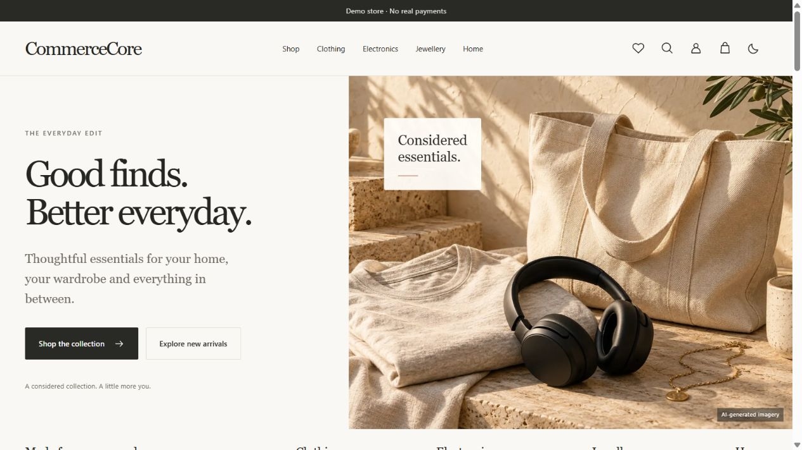
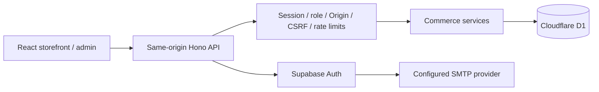

# CommerceCore

A full-stack e-commerce demo with 100 sample products, email-confirmed accounts, persistent shopping bags and an audited administration workspace.

**[Open the live store](https://commercecore.shoaibakhtar86835.workers.dev)** · [Architecture](docs/architecture.md) · [Deployment](docs/deployment.md) · [Review status](docs/release-review.md)

> Portfolio demonstration. Products and photography are illustrative. Checkout simulates a payment; no money is collected and nothing is shipped.

## What it does

- Browse 100 products across seven categories, including clothing, electronics, jewellery, home and everyday essentials.
- Search, filter, sort and paginate; choose sizes/finishes and see database-driven prices, sale badges and availability.
- Use a responsive ivory/charcoal storefront with dark mode, subtle motion, reduced-motion support and a sliding shopping bag.
- Confirm an email, sign in, save a profile/Indian demo addresses, wishlist products and keep a cart across visits.
- Review a server-calculated quote and place a simulated order with stock checks and idempotency protection.
- Manage products, categories, inventory and order states through a role-protected administration workspace with audit records.

There is no default admin, shared password or seeded customer account. Roles are granted explicitly by the operator after registration.

## Preview



[View the mobile layout](docs/showcase-mobile.png)

## Run locally

Use **Node.js 24** and npm. A Cloudflare account is not needed for local development.

```sh
npm ci
npm run db:migrate:local
npm run db:seed:local
npm run auth:setup:local
npm run dev
```

Open the URL Wrangler prints, normally `http://localhost:8787`. Setup creates a random signing secret in ignored `.dev.vars` without printing it. Local accounts use PBKDF2 and do not send emails. Hosted accounts use Supabase Auth and custom SMTP. Never reuse a real password or enter real delivery/payment details in this demo.

For frontend hot reload, run `npm run dev:api` and `npm run dev:web`, with `APP_ORIGIN=http://127.0.0.1:5173` in `.dev.vars`; use that exact Vite origin. Remove the override for same-origin port 8787 development.

## Verify

```sh
npm run check
npm run format:check
npm run repo:check
npm audit --audit-level=high
```

`check` runs TypeScript, ESLint, Node tests with isolated real local D1 databases, the production frontend build, asset budgets and a Worker dry-run. Tests cover ownership, roles, CSRF, input limits, price/stock transactions, idempotency, cancellation, audit atomicity and hosted authentication boundaries. CI runs these checks without cloud credentials or access to the deployed database.

`repo:check` inspects Git upload candidates for known credential signatures, private runtime files and oversized files. It is an additional check, not a complete secret-detection guarantee. Local `.dev.vars`, database files, runtime state, production bindings and private dashboard screenshots stay out of Git.

## Stack and architecture

React 19, TypeScript, Vite, React Router and TanStack Query; Hono on Cloudflare Workers; Cloudflare D1 with prepared SQL and versioned migrations; Supabase Auth for hosted identities.



The Worker issues its own HttpOnly session cookie after verifying a confirmed provider identity. Provider tokens are not stored in browser storage or the application database. All selling prices, quotes and order totals are calculated server-side in integer paise. Catalog seeds are repeat-safe and never create credentials or reset users/orders.

| Path                         | Purpose                                                |
| ---------------------------- | ------------------------------------------------------ |
| `src/`                       | Storefront, account, checkout and admin UI             |
| `worker/`                    | API routes, guards, business services and repositories |
| `shared/`                    | Validated API contracts and catalog types              |
| `db/migrations/`, `db/seed/` | Database schema and sample catalog                     |
| `tests/`                     | API, SQLite and local D1 regression coverage           |
| `scripts/`                   | Setup, verification and explicit operator tools        |
| `docs/`                      | Architecture, API, security, design and evidence       |

## Deploy your own demo

Copy `wrangler.production.example.jsonc` to **ignored** `wrangler.production.jsonc`, then configure your own Cloudflare account, D1 database, exact app origin and Supabase publishable settings. Keep `AUTH_PUBLIC_ENABLED=disabled` until provider setup is complete. Store `AUTH_SECRET` through Wrangler's secret command, never in the config or frontend.

Follow [the deployment guide](docs/deployment.md), then run `npm run deploy:preflight` and `npm run deploy`. The guard rejects placeholder database IDs, invalid origins, unconfigured auth and real-payment mode. The GitHub workflow verifies source only; it does not automatically deploy or require production secrets.

## Scope and limitations

This is a working demo, not a commercial launch package. Real payment settlement, shipping, returns, tax compliance and admin image uploads are outside its current scope. Recovery is integrated and covered with an isolated provider mock; live password-reset acceptance remains a manual check. Free hosting/provider quotas and inactivity policies affect availability. Local tests and anonymous live checks do not establish production capacity or a business uptime guarantee.

See [account security and provider trade-offs](docs/accounts.md), [security policy](SECURITY.md), [contributing](CONTRIBUTING.md), [test coverage](docs/testing.md), [premium storefront](docs/premium-storefront.md) and [catalog/photo provenance](docs/catalog-expansion.md). Historical phase notes are implementation records; [the release review](docs/release-review.md) is the current status. Private QA screenshots are kept locally; only the clean homepage/mobile showcase images are included in source.
