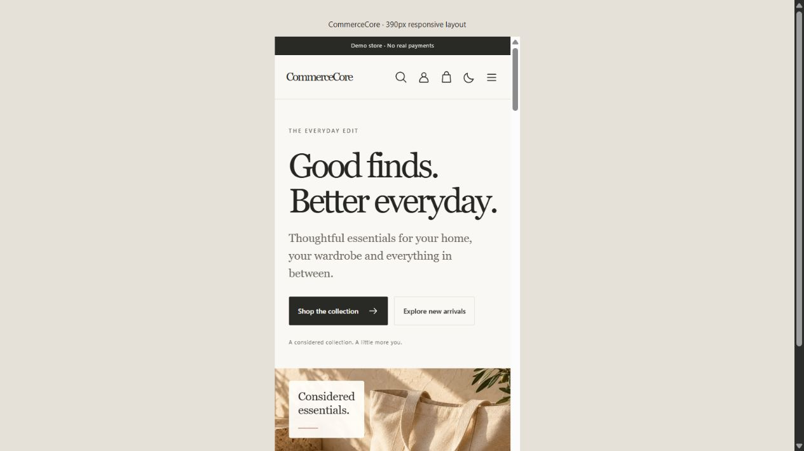

# CommerceCore

A full-stack e-commerce portfolio project: a photo-led storefront, authenticated shopping flows, server-priced demo checkout, and an audited admin dashboard.

[](https://github.com/Shoaibworkspace/commercecore/actions/workflows/ci.yml)
[Live store](https://commercecore.shoaibakhtar86835.workers.dev) · [Architecture](docs/architecture.md) · [API](docs/api.md) · [Deployment](docs/deployment.md)

> **Demo only:** products and photos are illustrative. Payments are simulated. No money is collected, and nothing is shipped.

## Screenshots

### Desktop storefront


### Mobile storefront



The mobile image shows a 390px responsive preview. The moon/sun theme switch stays visible in the header.

## What you can do

| Area           | Implemented features                                                                                                   |
| -------------- | ---------------------------------------------------------------------------------------------------------------------- |
| Catalog        | 100 sample products, 7 categories, 220 variants, photography, sale prices, search, filters, sorting and pagination     |
| Product pages  | Variant/size selection, stock availability, image gallery and add-to-cart beside/below the selling price               |
| Accounts       | Hosted email confirmation, sign-in, password-recovery integration, profile and saved Indian demo addresses             |
| Shopping       | Persistent cart/wishlist, sliding bag, quantities and saved products across visits                                     |
| Checkout       | Owned-address quotes, server-calculated totals, simulated success/decline, stock checks and idempotent order placement |
| Orders         | Saved order snapshots, customer order history and cancellation before shipping                                         |
| Administration | Products, categories, bundled images, inventory adjustments, order transitions, analytics and audit records            |
| Interface      | Responsive layouts, light/dark themes, keyboard access, reduced-motion support and subtle animations                   |

There is **no default admin or shared demo password**. Signup creates a customer; an operator explicitly grants admin access to an authorized registered account.

## How the application works

1. Browse the catalog and choose a variant or clothing size.
2. Register and confirm your email on the hosted store, then sign in.
3. Save a wishlist or add products to your shopping bag.
4. Add a **sample** delivery address and request an order quote.
5. The backend checks current prices/stock and calculates totals in integer paise.
6. Simulate a payment. Successful orders atomically record stock movement, order snapshots and audit data.
7. Review the order in your account; an administrator can manage its allowed next status.

Local development uses local password authentication without email delivery. The live deployment uses Supabase Auth plus custom SMTP. See [security and account behavior](docs/security.md).

## Tech stack

| Layer                 | Technology                                                                          |
| --------------------- | ----------------------------------------------------------------------------------- |
| Frontend              | React 19, TypeScript, Vite, React Router, TanStack Query, CSS/Tailwind              |
| Backend               | Hono API on Cloudflare Workers                                                      |
| Database              | Cloudflare D1 / SQLite, prepared SQL, versioned migrations                          |
| Hosted authentication | Supabase Auth and a configured SMTP provider                                        |
| Validation            | Shared Zod contracts                                                                |
| Quality checks        | Node tests, real isolated local D1, ESLint, TypeScript, Prettier and GitHub Actions |

Frontend assets and the backend API deploy together on one Worker origin. The separate source folders do not require separate hosting services.

## Project structure

```text
commercecore/
├── frontend/
│   ├── index.html
│   ├── src/
│   │   ├── pages/          # Store, product, account, checkout and admin screens
│   │   ├── components/     # Header, product cards, bag drawer and forms
│   │   ├── features/       # Catalog/account/cart/wishlist/checkout query logic
│   │   ├── styles/         # Shared theme and page-specific CSS
│   │   ├── lib/            # API client and cache invalidation
│   │   └── main.tsx        # App entry and routes
│   └── public/
│       ├── images/photos/  # Optimized AI-generated WebP product/lifestyle photos
│       ├── images/         # Supporting SVGs, placeholders and asset license
│       ├── catalog.json    # Seed/reference catalog; not the runtime database
│       ├── favicon.svg
│       └── _headers
├── backend/
│   ├── src/
│   │   ├── routes/         # HTTP endpoints
│   │   ├── middleware/     # Session, role, CSRF, rate and security guards
│   │   ├── services/       # Business rules and hosted-auth integration
│   │   ├── repositories/  # Bound SQL and atomic persistence
│   │   ├── validators/     # Request parsing and catalog validation
│   │   ├── app.ts
│   │   ├── index.ts
│   │   └── types.ts
│   └── db/
│       ├── migrations/     # Ordered schema changes
│       └── seed/           # Repeat-safe sample catalog
├── shared/                 # API schemas and types used by both layers
├── tests/                  # API, database, security and repository tests
├── scripts/                # Setup, catalog generation, verification and operator tools
├── docs/
│   ├── screenshots/        # Clean public README screenshots
│   ├── reports/            # Sanitized test/performance/audit evidence
│   ├── assets/             # Image-generation prompt provenance
│   └── *.md                # Focused guides listed below
├── .github/                # CI and pull-request template
├── package.json            # One dependency install and command entry point
├── vite.config.ts
├── tsconfig.*.json
├── wrangler.jsonc          # Safe local configuration
└── wrangler.production.example.jsonc
```

## Run locally

Requires **Node.js 24** and npm. No Cloudflare account is needed for local development.

```sh
git clone https://github.com/Shoaibworkspace/commercecore.git
cd commercecore
npm ci
npm run db:migrate:local
npm run db:seed:local
npm run auth:setup:local
npm run dev
```

Open the URL Wrangler prints, normally `http://localhost:8787`. The setup command privately generates `AUTH_SECRET` in ignored `.dev.vars`. Local D1 data stays in ignored `.wrangler/`.

**Frontend hot reload:** set `APP_ORIGIN=http://127.0.0.1:5173` in `.dev.vars`, run `npm run dev:api` and `npm run dev:web` in two terminals, and open that exact Vite origin. Remove the override for same-origin port 8787 use.

## Important commands

| Command                        | Purpose                                                     |
| ------------------------------ | ----------------------------------------------------------- |
| `npm run dev`                  | Build the frontend and run the local Worker                 |
| `npm run dev:web`              | Vite frontend hot reload                                    |
| `npm run dev:api`              | Local API server                                            |
| `npm run build`                | Build `frontend/` into root `dist/`                         |
| `npm run check`                | Types, lint, tests, build, asset budgets and Worker dry-run |
| `npm run format:check`         | Check source/document formatting                            |
| `npm run repo:check`           | Check Git candidates for known secrets/private files        |
| `npm audit --audit-level=high` | Check dependency advisories                                 |
| `npm run deploy:preflight`     | Read-only production configuration check                    |
| `npm run verify:hosted`        | Check the configured live catalog/auth boundaries           |
| `npm run repo:prepare`         | Export clean Git candidates without local state             |

The regression suite covers ownership, roles, CSRF, sessions, validation, prices, stock races, rollback, idempotency, cancellation and audit atomicity. See [test coverage and evidence](docs/testing.md).

## Deploy

Copy `wrangler.production.example.jsonc` to ignored `wrangler.production.jsonc` and configure **your own** Cloudflare/D1/Supabase resources. Keep public auth disabled until email/provider setup is complete. Put signing secrets in Wrangler's secret store, never in the frontend or committed config.

Follow [deployment instructions](docs/deployment.md). CI verifies source only; it never publishes to the reference deployment.

## Limitations

This is a working portfolio demo, not a commercial launch package. Real payment settlement, shipping, returns, tax compliance and admin file uploads are outside its scope. Hosted recovery is integrated and tested with an isolated provider mock; a real new-password/reset/sign-in test remains a human acceptance step. Free provider quotas and inactivity policies can affect availability. Automated tests are not an independent penetration test or capacity guarantee.

## Documentation

- [Architecture and database relationships](docs/architecture.md)
- [API routes, schemas and errors](docs/api.md)
- [Local/hosted setup and deployment](docs/deployment.md)
- [Security, sessions and account behavior](docs/security.md)
- [Testing, verification and performance evidence](docs/testing.md)
- [Frontend design, assets and catalog maintenance](docs/design.md)
- [Contributing](CONTRIBUTING.md) · [Security reporting](SECURITY.md)

Earlier phase diaries and duplicate notes were consolidated into these guides. Existing Git history retains the earlier records.
