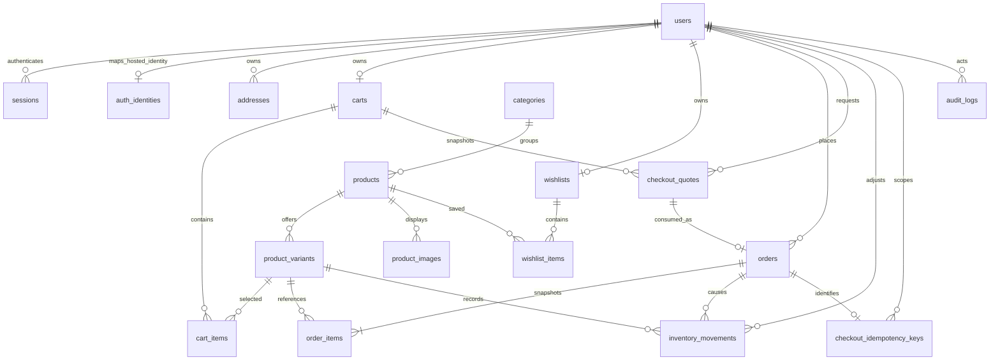

# Architecture and database decisions

## Recommended deployment

One Cloudflare Worker serves `/api/*` and uses static assets for the React SPA, with one D1 database. `run_worker_first` is restricted to API paths so public static requests do not needlessly consume dynamic request quota. No SSR or microservices are needed. Local Vite requests proxy to Wrangler.

Use SQL migration files as the single schema source. D1's SQLite semantics fit relational commerce, small public traffic, and the free budget. Prepared statements prevent data values becoming SQL. An ORM can be evaluated later without replacing transaction invariants.

## Relational model

The ordered SQL files in `backend/db/migrations/` define the current schema. The initial migration creates the core commerce tables; later migrations add account, checkout, administration and hosted-identity constraints. Diagram order cardinality describes a completed order; checkout triggers enforce the cross-row invariants. Primary keys are opaque IDs generated server-side. Money is integer paise, currency is INR, and order items retain name/SKU/variant/price snapshots. Delivery is copied as JSON so address edits cannot alter historical orders. Prices belong to variants rather than duplicated product price columns.

Tables are STRICT; CHECK constraints reject negative stock, invalid roles/statuses/quantities and inconsistent totals. Unique indexes enforce one cart/wishlist per user, one default address, one item per cart variant, and one idempotency key per user. Catalog products/variants used by orders cannot be physically deleted: archive them. Account deletion is restricted by retained orders; a future privacy process must anonymize retained customer data deliberately.

Timestamps use UTC Unix seconds. Services must set `updated_at` on writes; defaults are for insertion only. No blanket cascading deletion of orders is allowed. Audit and inventory actor references can be cleared on deliberate account deletion. Sample seed contains no credentials.

## Checkout strategy

See [test coverage](testing.md) for the final transaction design and tested failure cases. Server quotes snapshot up to 50 variants and 20 units per line, saved-address/cart versions and integer-paise pricing. Primary-started D1 sessions read/recover request keys. An order BEFORE trigger revalidates versions, ownership, expiry/policy, quoted price/metadata and stock in the write transaction. The AFTER trigger writes snapshots, guarded stock decrements, ledger rows and clears exactly the quoted cart. Explicit changed-row guards raise SQL errors on skipped writes.

One D1 batch includes the order insert (and its triggers), account-scoped idempotency record and request audit. Any error rolls back all effects. A unique quote link prevents distinct keys creating duplicate orders; equal-key retries return the committed order while changed payloads conflict. Declines create no order and leave stock/cart untouched. Local D1 tests cover last-unit races, multi-item rollback, skipped updates and injected item/ledger/cart/key/audit failures. These are correctness checks, not cloud throughput evidence.

## Cancellation and order states — implemented

`CREATED → CONFIRMED → PROCESSING → SHIPPED → DELIVERED`. Cancel only CREATED, CONFIRMED, or PROCESSING. CANCELLED and DELIVERED are terminal. Validate transitions server-side and use compare-and-set status updates inside one transaction. Cancellation restores each item's stock, writes unique cancellation movements, and changes status atomically. Repeated cancellation returns the saved order without duplicate restoration. Migration 0006 adds optimistic order versions, legal-transition and exactly-once cancellation triggers, guarded ledger-driven inventory adjustments and local role-change audits. Admin writes pair the mutation and audit in a D1 batch with explicit required-write checks. The ordered migrations include the identity and management tables beyond the initial schema. See [test coverage](testing.md).

## Operations and evolution

No queue is needed for synchronous demo orders. Hosted confirmation/recovery email is delegated to Supabase Auth and its SMTP provider; local authentication does not send email. Payments are simulated, and admin file uploads are outside the current scope. Images are bundled local assets with documented provenance. Catalog queries use indexed filters and bounded pagination; evaluate SQLite full-text search when catalog size warrants it. Cache only public catalog responses with explicit invalidation; no sessions/carts/orders are shared-cache eligible.

Free quota exhaustion means errors or unavailable dynamic features, not automatic upgrade. Database exceptions must produce safe JSON with request IDs. Monitor row reads/writes, database size, CPU, and request counts. Export backups in addition to limited Time Travel recovery. Scaling beyond the free target could require a different compute tier and a revisited authentication/analytics design.
